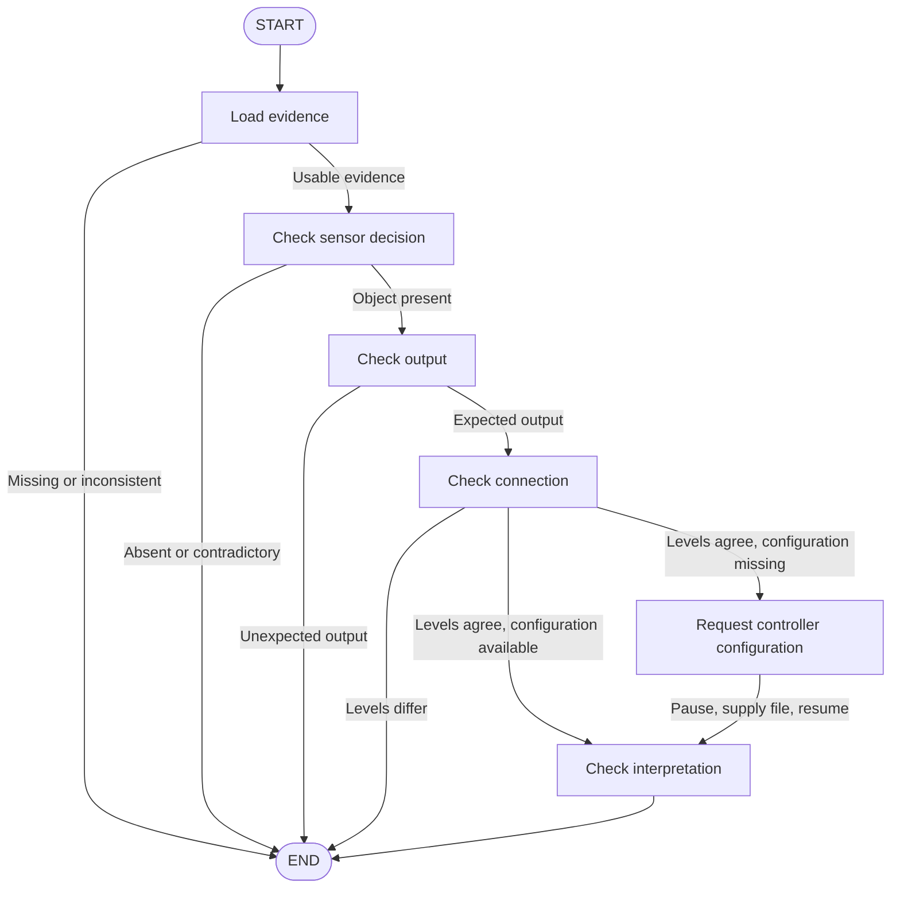

# SensorAssist — LangGraph Agent Lab

SensorAssist investigates fictional sensor/controller failures through explicit LangGraph workflows. It checks evidence, pauses when information is missing, and resumes the same investigation when that information arrives.

The project demonstrates state, conditional routing, evidence tools, human input, SQLite checkpoints, and evaluation. Current execution uses diagnostic rules or a scripted model substitute. Live LLM integration remains optional future work.

All sensor records and specifications are synthetic. This is an independent learning project.

[Try it](#try-the-guided-diagnosis) · [Architecture](#how-it-works) · [Verification](#verification) · [Learning guide](docs/learning-plan.md)

## The problem

A sensor reports that it saw an object, but the controller counts zero. Explaining that result requires connecting a test record, event log, sensor configuration, controller configuration, and two interface specifications.

In the example, the sensor sends LOW for “object present.” The controller's interpretation becomes known when the user supplies its configuration. That record says the controller expects HIGH, supporting an interface mismatch as the explanation. The workflow asks which convention was intended before recommending a change.

## Try the guided diagnosis

### Set up once

The verified development environment is Windows, PowerShell, and Python 3.11. Git is needed to clone the repository.

```powershell
git clone https://github.com/55B0/langgraph-agent-lab.git
cd langgraph-agent-lab
py -3.11 -m venv .venv
& .\.venv\Scripts\python.exe -m pip install -r requirements.lock
& .\.venv\Scripts\python.exe -m pip install --no-deps -e .
```

For an existing checkout, open PowerShell in its project folder, where `pyproject.toml`, `data`, and `src` are located. Run all following commands from that folder. The lock file records the verified dependency versions.

### Start and pause

```powershell
& .\.venv\Scripts\python.exe -m sensorassist --diagnose R-207 --data-dir data/cases/controller-mismatch
```

The output shows the executed nodes, followed by this pause:

```text
Status: awaiting_evidence
Next check: Supply controller configuration CTRL-201.
Diagnosis ID: <generated ID>
Node: request_controller (paused)
```

The saved evidence establishes that the sensor detected the object, produced LOW, and the controller received LOW. The controller configuration is a separate record that must be supplied explicitly.

### Supply the missing evidence

Copy the printed diagnosis ID. You can close PowerShell and reopen it in the same project folder. Replace `YOUR_ID` with that ID:

```powershell
& .\.venv\Scripts\python.exe -m sensorassist --resume-diagnosis YOUR_ID --controller-config examples/controller-config/CTRL-201.json
```

The resumed run executes `request_controller` and `check_interpretation`, using the earlier evidence saved in SQLite. Its final output includes:

```text
Status: explained
Next check: The sensor output and controller active level use different conventions. Confirm the intended HIGH/LOW convention with the configuration owner.
```

Add `--trace` to either command to inspect the complete state. The [case walkthrough](docs/log-investigation.md) explains the evidence references and alternative outcomes.

## How it works



Node functions perform the checks. Conditional edges select the next step from their results. State retains the evidence and accumulated checks. A SQLite checkpointer preserves the investigation across process restarts.

| Result | Example | Next step |
| --- | --- | --- |
| `awaiting_evidence` | Controller configuration is missing | Save progress and request the file |
| `explained` | Sensor sends LOW while controller expects HIGH | Confirm the intended interface convention |
| `unresolved` | Supplied settings contradict the recorded count | Reconcile the conflicting evidence |
| `needs_check` | Controller input differs from sensor output | Investigate wiring and input assignment |
| `incomplete` | A required run, log, or specification is missing | Supply the identified evidence |
| `consistent` | All checked layers agree in the passing case | Finish with the consistent result |

The supplied controller file is validated before resuming. A wrong controller ID or invalid file leaves the request pending.

## Other learning workflows

| Mode | Purpose |
| --- | --- |
| No flag | Inspect the original R-104/R-105 threshold records |
| `--graph` | Run fixed assessment with conditional missing-data handling |
| `--tools` | Read runs, compare configurations, and search specifications |
| `--read-log RUN_ID` | Read raw log lines with source references |
| `--simulate` | Run a bounded scripted model/tool loop and structured report |
| `--simulate --review` | Ask whether a threshold change was intentional |
| `--save-review` | Save that intent question to SQLite |
| `--resume-review ID --answer unsure` | Resume with `yes`, `no`, or `unsure` |
| `--evaluate` | Run the original workflows' five-check scorecard |

The original threshold case uses the default `data` directory. Use `--data-dir data/cases/controller-mismatch` for the controller case's evidence tools. The guided diagnosis uses `--diagnose` and `--resume-diagnosis` as shown above.

The intent review collects a human decision. The guided diagnosis collects a missing evidence file. Both use interrupts and saved state. Their local databases are ignored by Git:

- `.checkpoints/investigations.sqlite` stores threshold reviews.
- `.checkpoints/diagnoses.sqlite` stores guided diagnoses.

The scripted loop follows a predefined tool recipe. Its `completed` status means evidence gathering finished. An `explained` result comes from the explicit diagnostic rules in the fixed or guided workflow.

## Verification

```powershell
& .\.venv\Scripts\python.exe -m pytest -q
& .\.venv\Scripts\python.exe -m sensorassist --evaluate
```

The current version passed **56 local tests** covering evidence retrieval, tool budgets, routing, contradictory records, invalid controller files, and resume in a fresh process using saved evidence.

The separate scorecard passes **5 checks across 3 original scenarios**—threshold change, missing run, and a one-call tool limit. Guided diagnosis is covered by its integration tests. These results describe the synthetic cases and implemented rules.

## Code tour

| File | What to look for |
| --- | --- |
| [diagnosis.py](src/sensorassist/diagnosis.py) | `DiagnosisState`, diagnostic checks, `interrupt()`, and conditional edges |
| [guided_cli.py](src/sensorassist/guided_cli.py) | SQLite persistence, file validation, and `Command(resume=...)` |
| [tools.py](src/sensorassist/tools.py) | Four evidence tools with log pagination and source references |
| [agent.py](src/sensorassist/agent.py) | Message state, tool dispatch, budgets, and human intent review |
| [simulation.py](src/sensorassist/simulation.py) | The scripted model's predefined tool requests |
| [test_diagnosis.py](tests/test_diagnosis.py) | Branching, conflicting evidence, and restart/resume checks |

## Learning resources

The [learning plan](docs/learning-plan.md) contains the original section goals and approximate guided learning times. The [log investigation walkthrough](docs/log-investigation.md) covers the newer diagnosis exercise.

Earlier lessons explain [the fictional data](docs/section-01.md), [state and nodes](docs/section-02.md), [conditional routing](docs/section-03.md), [evidence tools](docs/section-04.md), and [the scripted model/tool loop](docs/section-05.md).

## Current scope

Implemented features include local evidence retrieval, rule-based diagnosis, structured reports, tool budgets, human input, persistence, and offline evaluation. The guided diagnosis supports the known fictional single-object test, exactly one event of each required kind, and logs up to 500 lines.

Free-form questions, autonomous model-selected tools, and live-model evaluation remain optional future work. Hardware integration and broader log formats require additional implementation and validation. Current modes run without an API key.

## Troubleshooting

- **PowerShell cannot find `.venv\Scripts\python.exe`** — change to the project folder and confirm setup has completed.
- **No pending evidence request** — use the ID printed by `--diagnose`. A completed diagnosis has already consumed its pending request.
- **No saved diagnoses** — run from the same project folder used to start the investigation, where `.checkpoints` was created.
- **Controller configuration was not accepted** — check the requested controller and configuration IDs. Retry the same diagnosis ID with the correct file.

## LangGraph references

- [Graph API](https://docs.langchain.com/oss/python/langgraph/graph-api)
- [Workflows and agents](https://docs.langchain.com/oss/python/langgraph/workflows-agents)
- [Persistence](https://docs.langchain.com/oss/python/langgraph/persistence)
- [Interrupts](https://docs.langchain.com/oss/python/langgraph/interrupts)
- [Testing graphs](https://docs.langchain.com/oss/python/langgraph/test)
