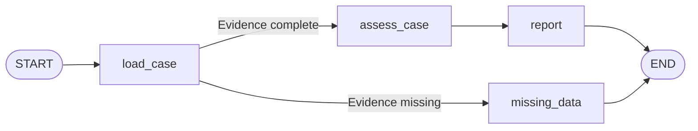
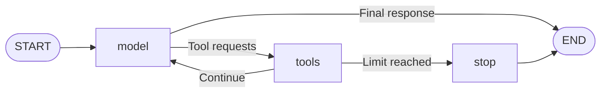
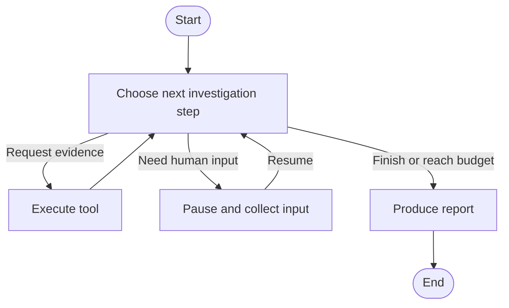

# LangGraph Agent Lab

Learning LangGraph by building **SensorAssist**, an agent that investigates fictional sensor software test failures.

**Status:** Sections 1-4 and the offline part of Section 5 are implemented: evidence tools, conditional routing, and a bounded model/tool loop using a clearly labeled scripted model. A real LLM connection and persistence are future work.

## Run Section 1

Use Python 3.11 and run these PowerShell commands from the repository root:

```powershell
py -3.11 -m venv .venv
& .\.venv\Scripts\python.exe -m pip install -r requirements.lock
& .\.venv\Scripts\python.exe -m pip install --no-deps -e .
& .\.venv\Scripts\python.exe -m sensorassist
& .\.venv\Scripts\python.exe -m pytest -q
```

The lock file records the resolved development dependencies from the verified Windows/Python 3.11 environment. To resolve dependencies again instead, install with `pip install -e '.[dev]'` inside the virtual environment and review the resulting version changes.

The inspector prints the recorded values and rule results for R-104 and R-105. This default mode does not call an LLM or execute a graph. See [Section 1 explained](docs/section-01.md) for the evidence.

## Run the graph (Sections 2-3)

After setup, run the LangGraph workflow from the repository root:

```powershell
& .\.venv\Scripts\python.exe -m sensorassist --graph
```

It prints each node's updated fields, the fields retained in shared state, and a final report with evidence references. Add `--trace` to print the complete state snapshots:

```powershell
& .\.venv\Scripts\python.exe -m sensorassist --graph --trace
```

To demonstrate the missing-evidence branch without changing any files, request an unknown run:

```powershell
& .\.venv\Scripts\python.exe -m sensorassist --graph --after-run R-999
```

The normal case returns `explained`; the unknown run returns `incomplete` and names the missing file. If the evidence exists but does not support the explanation, assessment returns `unresolved`.

The implemented graph is a scripted workflow with a conditional edge:



See [Section 2 explained](docs/section-02.md) for state and nodes, and [Section 3 explained](docs/section-03.md) for conditional routing. The graph applies the known fictional rule in code; it does not interpret the specification with an LLM.

## Run the tools (Section 4)

```powershell
& .\.venv\Scripts\python.exe -m sensorassist --tools
```

The demo reads both test runs, compares their configurations, and searches the fictional specification. Every call prints the tool name, input arguments, and returned evidence. The calls are scripted and use no model or API key.

| Tool | Input | Output |
|---|---|---|
| `read_test_run` | Run ID, such as `R-105` | Recorded observations, configuration reference, and source ID |
| `compare_configs` | Two configuration IDs | Changed fields and both source IDs |
| `search_spec` | Keyword query | Up to three matching passages with source IDs and line numbers |

The tools accept task arguments rather than arbitrary filesystem paths. Missing records and no-match searches have explicit results. See [Section 4 explained](docs/section-04.md) for the contracts, examples, and current limits.

The Section 3 graph remains a scripted workflow using its existing loader. The offline Section 5 loop below calls these tool objects through a tool execution node.

## Run the offline model/tool loop (Section 5)

```powershell
& .\.venv\Scripts\python.exe -m sensorassist --simulate
```

This runs real LangGraph orchestration and real local tools with a **scripted model substitute**. It uses no LLM, API key, or provider connection. The recipe requests two runs, compares their referenced configurations, searches the specification, and summarizes the returned evidence. Tool requests are predefined; the simulation does not understand arbitrary natural-language questions.



Requests and results accumulate in message state with matching tool-call IDs. The default reference case uses five model turns and four tool calls. To demonstrate stopping, run:

```powershell
& .\.venv\Scripts\python.exe -m sensorassist --simulate --max-tool-calls 1
```

The loop stops with `tool_call_limit` and preserves a result for every requested call, including rejected calls. `--max-model-turns` limits model invocations. Add `--trace` for full message-state snapshots, or `--after-run R-999` for incomplete evidence.

See [Section 5 explained](docs/section-05.md). The model is injected through an interface so a bound live model can be added later; no real-provider behavior has been verified yet.

## The problem

A failed test can leave evidence spread across run results, configuration files, and behavior specifications. SensorAssist will gather that evidence, explain what it supports, and identify what still needs investigation.

The project is a practical way to learn state, nodes, conditional edges, tool calling, checkpointing, human input, and agent evaluation through small, inspectable changes.

## First investigation

> Object detection passed in run R-104 but failed in R-105. What explains the change?

| Recorded value | R-104 | R-105 |
|---|---:|---:|
| Input signal | 0.55 | 0.55 |
| Detection threshold | 0.40 | 0.70 |
| Expected detection | true | true |
| Actual detection | true | false |

The fictional specification defines detection as `signal >= threshold`. The changed threshold explains the recorded output. The available artifacts do not establish whether that configuration change was intentional, so the next step is to confirm intent before recommending a configuration or test change.

This case gives us a conclusion we can verify and a clear boundary between observations, explanations, and missing information.

## Intended behavior

SensorAssist will:

- Read saved test runs and compare the configurations associated with them.
- Retrieve relevant passages from a small local specification.
- Produce a report with evidence references and unresolved questions.
- Stop within an enforced investigation budget.
- Pause for human input when necessary and resume the same investigation.

All sensor behavior, runs, identifiers, and specifications are synthetic. This is an independent learning project with no affiliation to SICK. Its outputs are demonstrations, not official product guidance.

## Planned architecture

The current implementation is the deterministic workflow above. The following diagram shows a future version with model-selected tools and human input within an explicit LangGraph `StateGraph`.



The model will choose evidence requests. Application code will validate requests and enforce stopping rules. Structured state and execution updates will make the flow inspectable.

## Build and learning roadmap

Estimates describe guided learning time, including hands-on implementation, experiments, explanation, and focused checks. Automated setup can be delegated. These are planning estimates, not measured durations.

| Section | Main topic | Approximate time |
|---|---|---:|
| 1 | Local setup and one fictional case | 1-1.5 hours |
| 2 | State, nodes, and a first executable graph | 1-1.5 hours |
| 3 | Conditional edges and incomplete evidence | 45-75 minutes |
| 4 | Three evidence tools and their contracts | 1-1.5 hours |
| 5 | Model/tool loop: simulation first, optional live LLM later | 1.5-2.5 hours |
| 6 | Structured reports, failures, and stopping | 1-2 hours |
| 7 | Checkpointing, human input, and resume | 1.5-2.5 hours |
| 8 | Evaluation, documentation, and demonstration | 2-3 hours |

Allow approximately **10-16 hours of focused work**, or **12-20 hours including a setup and debugging buffer**. Re-estimate after the first two sections.

See the [section-by-section learning plan](docs/learning-plan.md) for tasks, experiments, and completion criteria. Each section ends with a working result and a short explanation of what changed.

## Scope of the first version

The target is a local command-line demonstration with saved artifacts, a model/tool loop, and a small evaluation set. Offline simulation is the default learning path; a real tool-calling model is an optional later integration. A frontend, hardware integration, sensor simulator, vector database, and multiple agents are optional future experiments.

All current modes run without an LLM API key. A future live-model mode will require a provider and, for a hosted API, suitable local credentials. Such credentials must stay outside tracked files.

## How we will assess it

We will check whether reports are supported by retrieved evidence, whether unresolved cases remain unresolved, whether tool usage terminates, and whether paused investigations resume correctly.

A fixed retrieval workflow will provide a comparison using the same model, source artifacts, and report requirements. Evaluation will include successful cases and missing or conflicting evidence. A small synthetic dataset demonstrates behavior; it does not establish real-world diagnostic accuracy.

## References

- [LangGraph Graph API](https://docs.langchain.com/oss/python/langgraph/graph-api)
- [LangGraph quickstart](https://docs.langchain.com/oss/python/langgraph/quickstart)
- [Workflows and agents](https://docs.langchain.com/oss/python/langgraph/workflows-agents)
- [Persistence](https://docs.langchain.com/oss/python/langgraph/persistence)
- [Interrupts](https://docs.langchain.com/oss/python/langgraph/interrupts)
- [Testing graphs](https://docs.langchain.com/oss/python/langgraph/test)
