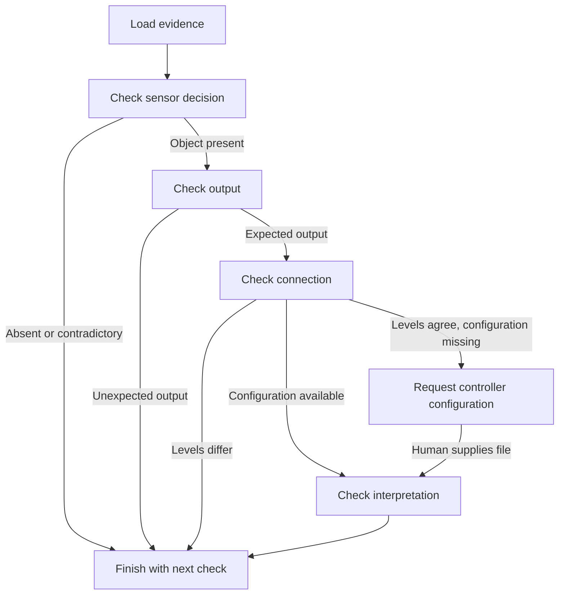

# Investigating a controller count failure

This is a fictional interface integration case. The question is: why did the controller count one object in R-206 and none in R-207, even though both runs logged OBJECT_PRESENT at the sensor?

## Evidence

The case lives in `data/cases/controller-mismatch`. Run records link to configurations. Event logs show the sensor decision, digital output, and controller input. Two specifications describe the sensor's output encoding and the controller's input interpretation.

The case has its own source directory so its specification passages remain separate from the original threshold lesson.

## Read the evidence

Run these commands from the project folder in PowerShell.

```powershell
& .\.venv\Scripts\python.exe -m sensorassist --data-dir data/cases/controller-mismatch --read-log R-206
& .\.venv\Scripts\python.exe -m sensorassist --data-dir data/cases/controller-mismatch --read-log R-207
& .\.venv\Scripts\python.exe -m sensorassist --data-dir data/cases/controller-mismatch --tools --before-run R-206 --after-run R-207 --spec-query "output polarity controller input"
```

The log tool reads the file and returns exact line numbers and a source ID. It accepts a run ID and bounded page arguments, keeping filesystem paths outside the model's tool arguments.

## What the evidence supports

- Both logs record OBJECT_PRESENT at line 3.
- R-206 records HIGH output and a controller count of 1 at lines 4-5. R-207 records LOW output and a count of 0.
- The sensor output polarity changed from active_high to active_low. The controller's active level is a separate evidence record, requested by the guided workflow.
- SPEC-OUTPUT-V1 explains that active_low encodes OBJECT_PRESENT as LOW. SPEC-CONTROLLER-V1 explains that the controller counts only its configured active level.

After supplying the example controller record, its HIGH active level supports an interface mismatch as the explanation within this fictional case. The startup LINK_RECOVERED warning appears before both tests, and the controller specification states that input sampling proceeds normally afterward.

The intended interface convention remains unknown. The next question for the human is whether the controller and sensor should use a HIGH or LOW active level. Either side could require a configuration correction depending on that answer.

## Guided diagnosis

The guided graph implements explicit rules for this single-object test. Each check determines which layer to inspect next.



Start the investigation:

```powershell
& .\.venv\Scripts\python.exe -m sensorassist --diagnose R-207 --data-dir data/cases/controller-mismatch
```

It checks the sensor, output, and connection, then saves a checkpoint with status `awaiting_evidence`. Copy the diagnosis ID and use it in a new terminal from the same project folder:

```powershell
& .\.venv\Scripts\python.exe -m sensorassist --resume-diagnosis YOUR_ID --controller-config examples/controller-config/CTRL-201.json
```

The example controller record is outside the case's source folder so it must be explicitly supplied. The resume command validates its controller ID, configuration ID, source ID, synthetic label, and active level before answering the saved request. Invalid files leave the request pending.

The resumed graph uses saved evidence and adds the controller record. With the example's HIGH active level it returns `explained`. A LOW active level would contradict the logged zero count and return `unresolved`. Earlier failed checks finish with their own next step, before requesting this file.

The checkpoint database lives at `.checkpoints/diagnoses.sqlite`. Add `--trace` to inspect the saved notebook. A controller record already present at `controller-configs/CTRL-201.json` within the chosen data directory is used directly.

This workflow supports the known fictional single-object test, one event of each required kind, and logs up to 500 lines. Missing files produce `incomplete`; inconsistent or unsupported evidence produces `unresolved`. A future model could choose tools for unfamiliar questions; the existing `--simulate` mode still follows its threshold recipe.

The fixed `--graph` assessment implements only the original steady-state detection specification. This case uses a different controller count test.
