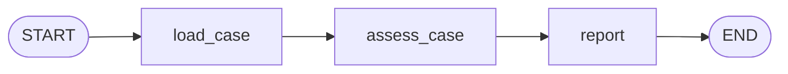

# Section 2: the first LangGraph workflow

This section turns the existing evidence inspection into a real LangGraph `StateGraph`. The workflow is deterministic and uses no LLM or API key. It applies the known fictional detection rule in code and loads the specification text as supporting evidence.

This walkthrough describes the original three-node path. The current version also includes [Section 3's missing-evidence branch](section-03.md), so the terminal now labels the graph as Section 3 and includes `missing_evidence` in state. Complete evidence still takes the path described here.

## Run it

From the repository root in PowerShell:

```powershell
& .\.venv\Scripts\python.exe -m sensorassist --graph
```

The existing command without `--graph` still runs the Section 1 inspector. For complete state snapshots, add `--trace`:

```powershell
& .\.venv\Scripts\python.exe -m sensorassist --graph --trace
```

## Follow the state

The request starts with two fields: `before_run_id: R-104` and `after_run_id: R-105`.

| Step | Reads | Adds to state |
|---|---|---|
| `load_case` | Requested run IDs and local evidence files | `evidence`: both runs, their configurations, the specification ID, and raw specification text |
| `assess_case` | `evidence` | `findings` and `status`: `explained` or `unresolved` |
| `report` | Evidence-based findings and status | `report`: findings, source references, and the next check |

The original request fields remain available throughout. Nodes return only their changes. LangGraph applies those updates to the existing state; fields omitted from an update remain unchanged. This version uses the default overwrite behavior for each updated field. List accumulation with a reducer will be introduced when the agent needs message history.



`build_graph` declares the state, registers the three node functions, connects the fixed edges, and compiles the executable graph. Streaming then exposes the actual node updates and the resulting state snapshots.

## Understand the conclusion

The graph checks that the recorded detections agree with `signal >= threshold`. It also checks that the recorded sensor, firmware, test, signal, and expectation are unchanged while the threshold and detection differ.

For the reference case, it reports that the threshold change explains the recorded detection change. It asks whether the change was intentional before recommending a configuration or test change.

If the supplied records do not isolate that change, it returns `unresolved`. That assessment happens inside a node. Both assessment outcomes still follow the edge to `report`. Section 3 introduces an earlier routing decision for missing evidence.

## Try one small experiment

Use a separate copy of `data/`. Change the second threshold to `0.40` without changing the recorded `actual_detection: false`, then run:

```powershell
& .\.venv\Scripts\python.exe -m sensorassist --graph --data-dir "path\to\your\copied-data"
```

Predict the result first. Under the fictional rule, signal `0.55` at threshold `0.40` predicts detection. The unchanged false observation contradicts that rule, so the graph should return `unresolved` rather than reuse the reference explanation. The automated graph tests perform this experiment on a temporary copy.

## Read only what matters first

Open `src/sensorassist/graph.py` and focus on `InvestigationState`, each node's return value, and `build_graph`. Follow those against the terminal trace. There is no need to study every Python detail to understand the graph.

The fixture checks and graph integration tests run with:

```powershell
& .\.venv\Scripts\python.exe -m pytest -q
```

## Current boundaries

The assessment implements only `SPEC-DETECTION-V1`; its rule is scripted rather than inferred from document text. Section 3 handles missing files through the new `missing_data` branch. Unsupported specification IDs and invalid JSON still surface as errors. General tool argument validation, LLM choices, checkpointing, and human pause/resume belong to later sections.

## Official references

- [Graph API: state, nodes, edges, and compilation](https://docs.langchain.com/oss/python/langgraph/graph-api)
- [Streaming: node updates and state values](https://docs.langchain.com/oss/python/langgraph/streaming)
