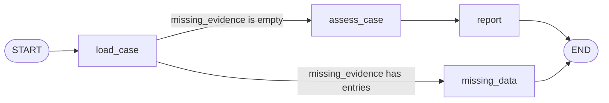

# Section 3: conditional edges

The graph now chooses its next node after loading evidence. The choice is made by our `route_after_load` function; LangGraph executes the selected path.

## Compare two runs of the workflow

From the repository root in PowerShell, run the complete case:

```powershell
& .\.venv\Scripts\python.exe -m sensorassist --graph
```

Expected executed nodes: `load_case`, `assess_case`, `report`. The reference case returns `Status: explained`.

Then request an unknown run:

```powershell
& .\.venv\Scripts\python.exe -m sensorassist --graph --after-run R-999
```

Expected executed nodes: `load_case`, `missing_data`. The result is `Status: incomplete`, with `runs/R-999.json` listed as missing. The assessment and normal report nodes do not execute. This command does not change the source data.

`--before-run` and `--after-run` select the comparison IDs; their defaults remain R-104 and R-105. Add `--trace` to inspect the complete state snapshots.

## Follow the decision



1. `load_case` adds available evidence and a `missing_evidence` list. Missing files are recorded by their paths within the data directory. Successfully loaded run/configuration pairs remain in evidence.
2. LangGraph calls `route_after_load` with the updated state.
3. Our router returns the name `assess_case` or `missing_data`.
4. LangGraph executes that node. The incomplete branch formats its own result and finishes at `END`.

The key registration in `build_graph` is:

```python
builder.add_conditional_edges(
    "load_case",
    route_after_load,
    {"assess_case": "assess_case", "missing_data": "missing_data"},
)
```

This replaces the original fixed edge from `load_case` to `assess_case`. We do not keep both registrations, because a fixed edge would also execute and undermine the intended exclusive branch.

## Understand the outcomes

| Status | Meaning | Path after loading |
|---|---|---|
| `explained` | Complete evidence supports the threshold-change explanation | `assess_case` -> `report` |
| `unresolved` | Evidence is present but does not support that explanation | `assess_case` -> `report` |
| `incomplete` | A required run, referenced configuration, or specification file is missing | `missing_data` -> `END` |

This is still a deterministic workflow. The router reads a list in state; it does not ask an LLM to choose. It returns an incomplete result rather than pausing for input. Human pause/resume will be introduced with checkpointing later.

The list uses the default overwrite behavior: each load returns its current missing files, replacing any earlier value for that field. No custom reducer or cross-run memory is needed here.

## Verification and boundaries

The tests cover the complete path, an unknown run, missing run/configuration/specification files, and the exact executed branch. They also check that malformed JSON remains an error instead of being mislabeled as missing evidence. Missing-file experiments use temporary copies of the data.

Unsupported specifications and malformed artifacts still surface as errors. A missing run may hide a further missing configuration until that run is available; the reported list contains the file failures actually encountered. The next section will define more general evidence tools and their argument contracts.

Run all checks with:

```powershell
& .\.venv\Scripts\python.exe -m pytest -q
```

## Official reference

- [LangGraph conditional edges](https://docs.langchain.com/oss/python/langgraph/graph-api#conditional-edges)
