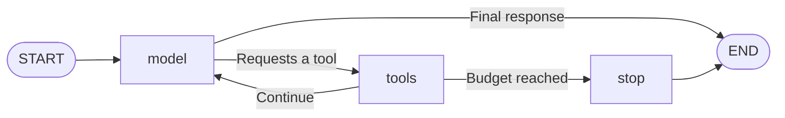

# Section 5: a real tool loop with a simulated model

The model's decisions are scripted. LangGraph execution, tool inputs, tool results, message updates, and stopping limits are real. This mode uses no LLM, API key, paid service, or provider connection.

## Run it

From the repository root in PowerShell:

```powershell
& .\.venv\Scripts\python.exe -m sensorassist --simulate
```

The script asks for R-104, then R-105, then compares the configuration IDs returned by those tools, then searches the specification. Its final summary lists the actual returned records, changes, and source references. It does not claim to have reasoned independently about a cause.

The reference case uses five model turns and four tool calls. You can select different IDs with `--before-run` and `--after-run`; the script receives these IDs directly rather than extracting meaning from the user message.

## Follow the loop



1. The initial `HumanMessage` describes the comparison.
2. The scripted model returns an `AIMessage` with a tool name, arguments, and call ID.
3. The router selects the `tools` node because that message contains a tool request.
4. The node dispatches the request through LangGraph's built-in `ToolNode`. Its `ToolMessage` carries the result and the matching call ID.
5. The graph returns to `model`, which sees the accumulated messages and follows the next scripted instruction.
6. A model message without tool requests ends the loop.

The state also holds `model_turns`, `tool_calls_used`, `status`, and a stopping reason when applicable. `messages` uses LangGraph's `add_messages` reducer: new messages are accumulated rather than overwriting the conversation. The reducer can also replace a message with the same message ID; tool-call IDs separately associate requests with results.

Add `--trace` to print complete state snapshots, including serialized messages:

```powershell
& .\.venv\Scripts\python.exe -m sensorassist --simulate --trace
```

## Try two controlled changes

Ask for a missing run:

```powershell
& .\.venv\Scripts\python.exe -m sensorassist --simulate --after-run R-999
```

The script reads the missing-record result and ends with an incomplete-evidence summary. The loop status `completed` means the script finished, not that it found a cause or gathered complete evidence.

Limit tool usage:

```powershell
& .\.venv\Scripts\python.exe -m sensorassist --simulate --max-tool-calls 1
```

Only the first call is dispatched. The next request receives a `budget_exhausted` tool result and the graph enters `stop`. It does not silently discard an unanswered request or claim a completed diagnosis.

`--max-model-turns 1` demonstrates the independent model-turn limit. Zero tool calls is a valid budget and executes no tools. The model-turn limit must be positive. Budgets apply to individual requests within a batch; excess requests each receive a matching rejection result. Dispatched attempts count against the tool budget even when a tool name is unknown or execution returns an error.

The tool message's protocol status `success` means execution returned normally. Its content can still say `not_found`; this is an expected evidence outcome.

## Model interface and future live mode

`build_agent(data_dir, model, ...)` accepts an object whose `invoke(messages)` returns an `AIMessage`. `ScriptedModel` implements that interface without reading source files directly. It uses actual `ToolMessage` contents, so changing evidence changes the final summary. It keeps no hidden iterator counter between runs.

A future live adapter must bind the same tool schemas before use, use private local credentials if needed, and set finite request timeouts and retries. The graph currently bounds turns, tool dispatches, and recursion. These counters do not interrupt an arbitrarily blocking model or tool function, and they are not provider token or monetary budgets.

No live provider adapter is implemented or verified. The optional live integration should remain separate from this reproducible offline mode. Persistence and human approval are also future steps.

## What the tests establish

The suite verifies the real reference tool results, retained history, matching request/result IDs, changed source data, missing runs, tool-call budgets, model-turn limits, batched requests, unknown tools, repeated independent runs, and the CLI. The reference integration test blocks socket connections to verify that this path does not depend on a network.

This tests graph engineering and protocol handling. It does not evaluate an LLM's ability to choose tools, follow new instructions, or produce accurate free-form answers.

Run tests with:

```powershell
& .\.venv\Scripts\python.exe -m pytest -q
```

## Official references

- [LangGraph tool-loop quickstart](https://docs.langchain.com/oss/python/langgraph/quickstart)
- [Message state and reducers](https://docs.langchain.com/oss/python/langgraph/graph-api#working-with-messages-in-graph-state)
- [Testing with fake models and real integrations](https://docs.langchain.com/oss/python/langchain/test)
